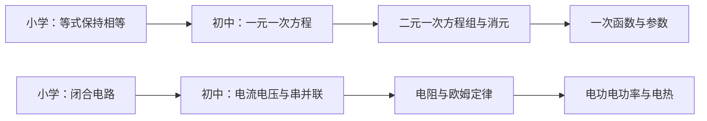

# 中国小学及初中课程知识图谱

基于教育部 2022 年版义务教育课程标准，沿用 [Marble Skill Taxonomy](https://github.com/withmarbleapp/os-taxonomy) 的知识节点、依赖关系、课程标准映射和领域聚类四层结构。本 fork 新增小学到初中的贯通图谱，原小学独立版继续保留。

**版本：`cn-compulsory-2022-draft.1`。AI 辅助编写，待学科专家审核；不是官方知识图谱，也不宣称课标逐条完整覆盖。**

| 数据集 | 范围 | 节点 | 依赖 | 章节定位 | 聚类 |
|---|---|---:|---:|---:|---:|
| [贯通版](data/cn-compulsory) | 小学及初中 1—9 年级 | 557 | 812 | 159 | 154 |
| [小学独立版](data/cn-primary) | 小学 1—6 年级 | 308 | 380 | 81 | 77 |

本次新增 **249 个初中节点、432 条依赖**，其中 **188 条**从初中节点指向小学基础。小学节点 ID、内容、映射和原有依赖保持不变。贯通版包含小学数据，使用时不应再把两个数据集直接拼接。

## 初中学科与路径

| 学科／课程来源 | 新增节点 |
|---|---:|
| 数学 | 41 |
| 历史 | 24 |
| 物理 | 23 |
| 生物学 | 22 |
| 艺术 | 21 |
| 化学 | 20 |
| 地理 | 18 |
| 语文 | 15 |
| 综合科学路径（来源为科学课标） | 14 |
| 英语 | 12 |
| 道德与法治 | 11 |
| 信息科技 | 10 |
| 劳动 | 9 |
| 体育与健康 | 9 |

14 是图谱所收录的学科来源类别数，**不表示每个学生必须同时修读 14 门课**。

- 采用六三学制。大部分初中节点的 `gradeRange:[7,9]` 表示初中阶段归属，不规定七年级就开课、学习完成或排在某册教材。没有把理化生等课程的地方开设年级写成全国统一安排。
- 科学课标的初中内容与物理、化学、生物学课标分开编写。`sciencePathway` 区分 `integrated` 与 `disciplinary`，选择应依据当地课程；不声称两个路径逐节点等价，不建立跨路径必需依赖。地理在此图谱中单列。
- 艺术保留原课标学段：七年级音乐、美术承接 6—7 年级；七年级单独舞蹈、戏剧、影视标为有条件学校开设；8—9 年级艺术标为选项。可选七年级课程只作为后续学习的 soft 背景。
- 体育球类是选学项目框架；尚未完整展开田径、体操、水上、冰雪及传统体育等专项。
- 外语目前采用英语路径，未纳入日语、俄语。五四学制、地方和校本课程、各教材版次的单元课时映射尚未提供。

每个初中节点的课程路径与选项位于 `provenance.scope.topicOptions`。工具展示或安排课程时应读取这些信息；本项目没有自动生成地区课表。

## 数据与课标来源

[官方课标发布入口](https://www.moe.gov.cn/srcsite/A26/s8001/202204/t20220420_619921.html)。保留既有 9 份课标，新增历史、地理、物理、化学、生物学 5 份；URL、SHA-256、PDF 页数和页码偏移见 [新增来源清单](authoring/cn-junior/sources.json) 与 [小学来源清单](authoring/cn-primary/sources.json)。使用官方入口所链接的 2022 年版文件，包括其更新后的化学附件；不宣称已完成此后的所有修订核查。

| 贯通版文件 | 内容 |
|---|---|
| [topics.json](data/cn-compulsory/topics.json) | 稳定 ID、类型、学科领域、描述、观察证据、评估提示和来源键 |
| [dependencies.json](data/cn-compulsory/dependencies.json) | `topicId` 依赖 `prerequisiteId`，附 hard/soft 强度和理由 |
| [curriculum-standards.json](data/cn-compulsory/curriculum-standards.json) | 14 份课标及项目自编章节定位符，采用 codes-only 格式 |
| [clusters.json](data/cn-compulsory/clusters.json) | 学科、领域与起始年龄聚类 |
| [provenance.json](data/cn-compulsory/provenance.json) | 节点年级、原学段、PDF 与印刷页码、来源及选项路径 |
| [manifest.json](data/cn-compulsory/manifest.json) | 版本、分学段数量、跨学段关系数和文件校验和 |

核心四份数据继续遵守上游 schema，扩展信息放在 provenance。`S4-*` 等是项目编号，不是教育部条款号；159 是项目章节定位数，不是官方要求数或覆盖率。章节范围可能同时包含多学段文字，节点所取学段另外记录，不能把引用范围当作逐字出处。OCR 仅辅助阅读，所有映射仍待专家复核。

`hard` 和 `soft` 均为编写者的教学假设，不是教育部规定或经过实证验证的学习门槛。`centrality:null`，没有学生掌握度或校准模型。年龄沿用“最低年级 +5 至最高年级 +6”的展示约定；年级归属以 provenance 为准。

## 构建、验证与查询

需要 Python 3.9+、Node.js 20+，无第三方运行依赖；构建不访问网络。

```sh
npm run build:cn-all
npm run validate             # 原上游数据
npm run validate:cn-all      # 小学独立版 + 贯通版
npm test

node scripts/query-cn.mjs search 方程 --dataset compulsory --stage junior
node scripts/query-cn.mjs topic mt_cn_jm_linear_eq --dataset compulsory
node scripts/query-cn.mjs prerequisites mt_cn_jm_linear_eq --dataset compulsory
node scripts/query-cn.mjs prerequisites mt_cn_ja_dance_create --dataset compulsory --include-soft
node scripts/query-cn.mjs unlocks mt_cn_math_equation_property --dataset compulsory
```

不指定 `--dataset` 时保留旧行为，查询小学独立版。`--stage` 只用于 search；先修查询保留完整的小学衔接链，默认仅遍历 hard 边，按拓扑顺序去重输出。`topic` 同时显示课标 URL、页码和课程路径。查询工具不计算学习掌握度。

下面箭头表示“基础 → 后续学习”，与 JSON 中 `topicId` 指向 `prerequisiteId` 的存储方向相反：



图示只展示部分依赖。自动验证包含引用、数量、校验和、核心 schema、hard+soft 全图无环、年级和页码边界、课程路径、选项标记及小学兼容性。当前 21 项测试通过。schema 检查器只实现本仓库四份核心 schema 使用的词汇；不等于通用 JSON Schema 引擎。结构校验不代表学科审核完成。

编写入口：[初中记录](authoring/cn-junior/compile_records.py)、[小学记录](authoring/cn-primary/compile_records.py)。生成的 groups 由 [贯通版构建脚本](scripts/build-cn-compulsory.py) 编译。修改后应重新构建，不能仅手改输出 JSON。

## 范围、许可与后续审核

[覆盖缺口](COVERAGE-CN.md) · [维护流程](CONTRIBUTING-CN.md) · [小学独立版说明](README.primary.zh-CN.md)

当前是主要领域框架，节点粒度不均衡；综合科学初中部分尤其偏概念框架，尚未完成全部内容要求、实验和活动的细分。历史节点通常涵盖一个时期主题，不能直接视为一课或一道题。所有节点仍为 `pending-subject-expert-review`，后续应由学科教师检查内容、页码、衔接与依赖强度。

保留 Marble 上游署名及许可，数据库使用 ODbL-1.0，自编文字使用 CC-BY-SA-4.0。中国课程扩展由 soarhe 的 fork 借助 AI 编写。教育部原 PDF 的权利不随本项目重新授权，仓库不附原 PDF 或整段课标正文；引用时注明本 fork 数据版本、上游项目及官方来源。
